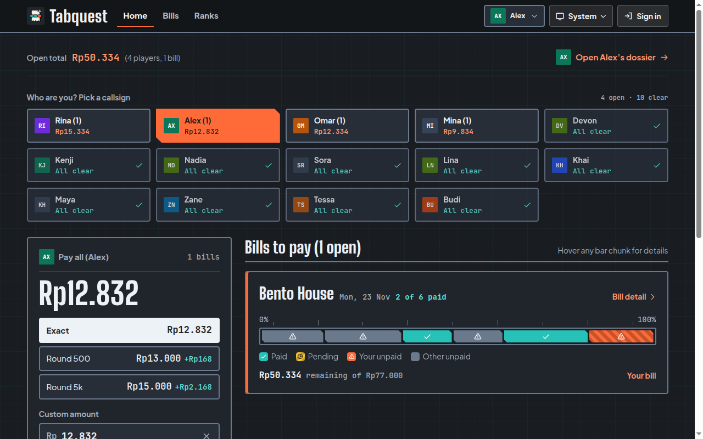
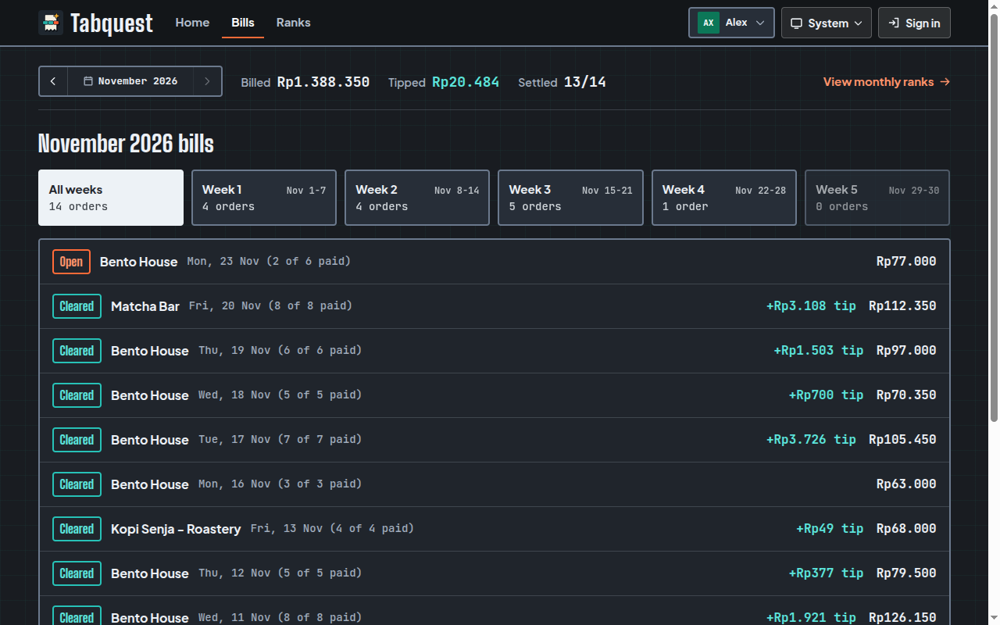
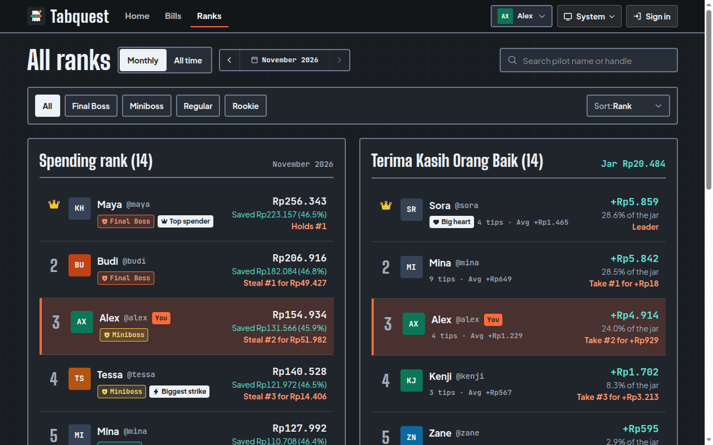

# Tabquest v2

A fast, game-inspired group bill-splitting and tip leaderboard app built for a **$0 Cloudflare stack** (Cloudflare Workers, D1, R2, and Better Auth).

Divide group orders fairly across your squad, track who owes what in real time, gamify generous round-ups on the monthly tip wall, and redact/upload receipts directly to R2 from the browser.

---

## Screenshots

### Home - Pay Dashboard


### Monthly Bills Archive & Week Filter


### Ranks & Tip Wall


---

## Features

- **Focused Pay Dashboard (`/`):** Global open tabs sorted by highest unpaid amount, wrapped callsign grid with avatars, `Pay all` round-up tip simulator (`Exact`, `Round 500`, `Round 1k`, `Round 5k`, or custom amount), and boss-armor HP bars per open bill.
- **Bills Archive (`/bills`):** Browse orders by month and week (with date ranges), see settled/open status, and open itemized bill breakdowns (`/b/$publicId`) with R2-backed receipt previews.
- **Ranks & Player Dossiers (`/ranks`, `/players/$playerId`):** Monthly and all-time Spending & Tip leaderboards ("Terima Kasih Orang Baik"), tiers, badges, spending insights, custom usernames, and custom avatar uploads.
- **Admin Suite (`/admin`):**
  - 4-step **New Bill** wizard with browser-side `<canvas>` receipt crop & black-box PII redaction, WebP compression, optional async OCR, and drag-and-drop item allocation.
  - **Collect All** slide-over desk for 1-click multi-bill settlement with tip attribution.
  - **Players & Moderation** (account pre-linking by email, rounding-rupiah assignee, avatar moderation, and username lock/force).
  - **White-label Branding & Payment Methods** (logged-in users only).
- **Zero-Password Auth:** Better Auth on D1 with **Shoo (`https://shoo.dev`)** OIDC + PKCE as zero-setup primary login (plus optional direct Google OAuth fallback) and strict single-admin access via `ADMIN_EMAIL`.

---

## Tech Stack

- **Framework:** TanStack Start (React 19, TypeScript, Vite)
- **Runtime:** Cloudflare Workers (`@cloudflare/vite-plugin` + `wrangler`)
- **Database:** Cloudflare D1 + Drizzle ORM (`db.batch` atomic writes, partial indexes)
- **Object Storage:** Cloudflare R2 (receipt images & custom player avatars)
- **Auth:** Better Auth (`drizzleAdapter` + `admin` + `genericOAuth` for Shoo)
- **Styling:** Tailwind CSS v4 + Base UI primitives + Phosphor Icons

---

## Local Development Setup

### Prerequisites
- [Bun](https://bun.sh/) (`>= 1.2`)
- [Just](https://github.com/casey/just) (optional, for convenience recipes in `justfile`)
- A Cloudflare account (only needed for remote deployment; local dev uses Wrangler's local D1/R2 emulator)

### 1. Install dependencies

```bash
bun install
```

### 2. Configure local environment variables

Copy `.dev.vars.example` to `.dev.vars` (gitignored):

```bash
cp .dev.vars.example .dev.vars
```

Edit `.dev.vars`:

```dotenv
BETTER_AUTH_URL=http://localhost:3000
BETTER_AUTH_SECRET=<generate with: openssl rand -base64 32>
ADMIN_EMAIL=you@example.com
```

> Primary login uses **Shoo (`https://shoo.dev`)** OIDC + PKCE and requires no OAuth app credentials. To optionally enable direct Google OAuth, see [docs/setup-google-oauth.md](docs/setup-google-oauth.md).

### 3. Apply local D1 migrations

```bash
just db-migrate-local
# or:
CI=true bunx wrangler d1 migrations apply tabquest-db --local
```

### 4. Start the dev server

```bash
bun run dev --port 3000
```

Open `http://localhost:3000` in your browser.

---

## Production Deployment (Cloudflare Workers)

### 1. Provision Cloudflare D1 and R2

```bash
bunx wrangler d1 create tabquest-db --location apac
bunx wrangler r2 bucket create tabquest-receipts
```

Create a local `wrangler.prod.jsonc` (gitignored) copied from `wrangler.jsonc`, and fill in:
- Your real `database_id` from `wrangler d1 create`
- Optional custom domain under `"routes"`:

```jsonc
{
  "routes": [
    { "pattern": "your-domain.example.com", "custom_domain": true }
  ]
}
```

### 2. Apply remote D1 migrations

```bash
CI=true bunx wrangler d1 migrations apply tabquest-db --remote --config wrangler.prod.jsonc
```

### 3. Build & deploy

```bash
just deploy
# or:
bun run build && bunx wrangler deploy --config wrangler.prod.jsonc
```

### 4. Set production Worker secrets

```bash
printf '%s' "https://your-domain.example.com" | bunx wrangler secret put BETTER_AUTH_URL
openssl rand -base64 32 | tr -d '\r\n' | bunx wrangler secret put BETTER_AUTH_SECRET
printf '%s' "you@example.com" | bunx wrangler secret put ADMIN_EMAIL
```

### 5. Optional: Receipt OCR

The New Bill wizard supports async receipt OCR via an external vision endpoint (for example, a self-hosted service behind a Cloudflare Tunnel + Cloudflare Access Service Token):

```bash
bunx wrangler secret put VISION_API_URL
bunx wrangler secret put VISION_API_PROVIDER
bunx wrangler secret put VISION_API_TOKEN
bunx wrangler secret put CF_ACCESS_CLIENT_ID
bunx wrangler secret put CF_ACCESS_CLIENT_SECRET
```

If left unset, OCR cleanly returns `503` while manual receipt entry and redaction continue working normally.

---

## Verification & Scripts

```bash
just check        # TypeScript typecheck + Oxlint + Bun unit/schema/service tests
just build        # Production Cloudflare Workers bundle
just db-generate  # Generate Drizzle SQL migrations from src/db/schema.ts
```
